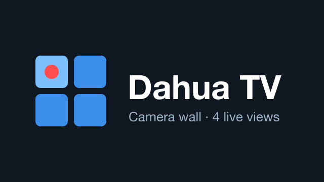
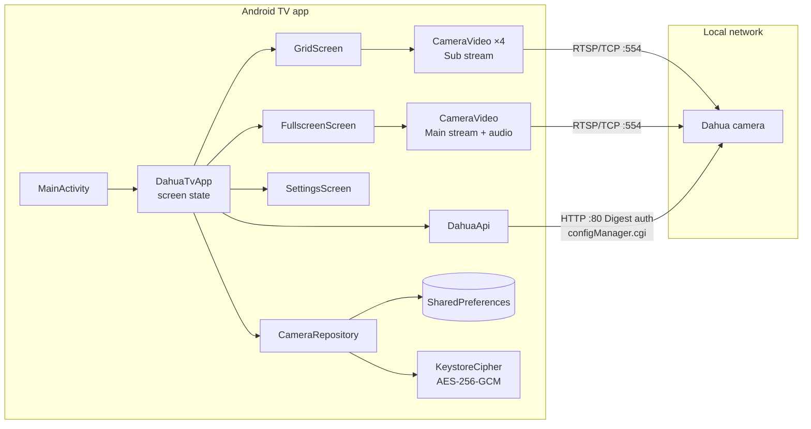

# Dahua TV

[](https://github.com/mantolak/dahua-tv/actions/workflows/ci.yml)

An Android TV app that turns a TV into a **camera wall for Dahua IP cameras** on the local network.
It shows four cameras live in a 2×2 grid, opens any of them fullscreen in 4K with one press of the
remote, and keeps every stream running unattended: reconnecting after drops and never locking
cameras out with repeated bad logins.

No cloud, no NVR, no account: the TV talks directly to the cameras over RTSP. Camera passwords are
typed once on the TV and stored encrypted with a key from the TV's secure hardware.

<p align="center"></p>

---

## Contents

- [Features](#features)
- [Using the app](#using-the-app)
- [Installing on a TV](#installing-on-a-tv)
- [Architecture](#architecture)
- [Video pipeline](#video-pipeline)
- [Camera login and lockout protection](#camera-login-and-lockout-protection)
- [Camera HTTP API](#camera-http-api)
- [Security](#security)
- [Build system](#build-system)
- [Development environment (macOS)](#development-environment-macos)
- [Testing](#testing)
- [Tools](#tools)
- [Troubleshooting](#troubleshooting)
- [Known limitations and ideas](#known-limitations-and-ideas)

---

## Features

| | |
|---|---|
| **2×2 live grid** | Four cameras at once on the camera's **sub-stream** (`subtype=1`, e.g. 704×480). |
| **Fullscreen 4K** | OK on a tile plays that camera's **main stream** (`subtype=0`, e.g. 3840×2160). Back returns to the grid. |
| **FPS overlay** | Every video shows stream, resolution and *measured* FPS against the FPS configured in the camera, e.g. `Sub 704×480 · 19.8/20 fps`. |
| **Camera's own name** | Tiles show the channel title set in the camera (its OSD name), read from the camera's HTTP API. |
| **Audio in fullscreen** | The camera's G.711 audio, **muted by default**; a speaker button toggles it. The grid never decodes audio. |
| **Self-healing streams** | Exponential-backoff reconnect (1 s → 30 s), plus a watchdog for streams that freeze silently. |
| **Lockout-safe logins** | A refused login is never retried automatically, so cameras don't block the TV. |
| **Encrypted credentials** | User and password are stored with AES-256-GCM using an Android Keystore key. |
| **Built for the remote** | D-pad focus everywhere, TV-style text fields, overscan-safe layout, screen never sleeps. |

**Target hardware:** Dahua IP cameras that stream H.265 or H.264 over RTSP, and an Android TV or Google TV
device running Android 8.0 (API 26) or newer. Developed on a Sony BRAVIA (MediaTek MT5895, Android 12).

---

## Using the app

### Screens and remote keys

| Screen | Key | Action |
|---|---|---|
| **Grid** | ← ↑ → ↓ | Move between tiles (white frame = selected) |
| | **OK** | Open the camera fullscreen · on an empty tile: open its settings · on a refused-login tile: check the login again |
| | **Hold OK** (≈1 s) | Edit this camera's settings |
| **Fullscreen** | **OK** | Toggle sound (speaker icon, bottom-right) |
| | **Back** | Return to the grid |
| **Settings** | ↑ ↓ | Move between fields without opening the keyboard |
| | **OK** | Edit the field (keyboard opens) |
| | Keyboard **Next / Enter** | Confirm and move to the next field |
| | **Back** | Leave editing · press again to cancel the screen |

### Adding a camera

Select a tile and press **OK** (empty tile) or **hold OK** (existing camera), then fill in:

| Field | Typical value | Notes |
|---|---|---|
| Name | `Gate` | Shown only until the camera reports its own name |
| IP address | `192.168.1.20` | IPv4 address or hostname |
| RTSP port | `554` | Dahua default |
| Username | `admin` | |
| Password | | Stored encrypted; never shown or logged |
| Channel | `1` | `1` for a single camera; NVR channel number otherwise |

Move down to **Save**. Validation runs on Save: bad IP, port outside 1–65535, channel outside 1–64,
or a password without a user are flagged under the field. **Remove camera** clears the slot.

### What a tile can show

| Message | Meaning | What to do |
|---|---|---|
| `Checking login…` | One HTTP login check before video starts | Wait about a second |
| `Connecting…` | RTSP session being set up | — |
| `Can't reach camera` / `Camera not responding` | Network problem; retried automatically | Check the camera's power and network |
| `No video` | Stream froze for 15 s; reconnecting | — |
| `Wrong user or password` | Camera answered 401 | Hold OK to fix, or press OK to retry once |
| `Camera blocked this TV after failed logins` | Camera answered 403 (lockout) | Wait about 10 min, then press OK |
| `TV has no free video decoder` | The TV ran out of hardware decoders | See [decoder limits](#decoder-limits) |

---

## Installing on a TV

### Option A: APK on a USB drive (no developer setup)

1. Build the APK (`./gradlew assembleDebug`) or take `app/build/outputs/apk/debug/app-debug.apk`.
2. Copy it to a FAT32/exFAT USB drive and plug the drive into the TV.
3. On the TV, install a file manager from Google Play (*File Commander* or *X-plore*).
4. **Settings → Apps → Security & restrictions → Unknown sources**: allow that file manager.
5. Open the APK in the file manager → **Install** (confirm the Play Protect prompt).
6. Start **Dahua TV** from the Apps row.

Updates install the same way over the old version. Saved cameras are kept, as long as the APK is signed
with the same key (the debug key from the same build machine).

### Option B: adb over the network (for development)

1. On the TV: **Settings → Device Preferences → About → Build**, press 7× to unlock Developer options.
2. **Developer options**: enable **USB debugging** and **Network debugging** (ADB over network).
3. From the computer:
   ```sh
   adb connect <TV_IP>:5555          # accept "Allow USB debugging?" on the TV, tick "Always allow"
   ./gradlew installDebug             # or ▶ Run in Android Studio with the TV selected
   ```

Google TV models that only offer **Wireless debugging** (pairing code) require the TV to be on Wi-Fi;
use `adb pair <TV_IP>:<pair_port> <code>` and then `adb connect <TV_IP>:<port>`.

---

## Architecture

A single-activity Jetpack Compose app with no navigation library, no DI framework and no database:
three screens, one repository and one small HTTP client.



### Source layout

```
app/src/main/java/com/dahuatv/app/
├── MainActivity.kt              Single activity; keeps the screen on; creates the repository
├── model/
│   ├── Camera.kt                Camera settings, Stream (SUB/MAIN), RTSP URL builders, percent-encoding
│   ├── CameraForm.kt            Raw form input → validated Camera (IPv4/hostname, port, channel rules)
│   └── LoginProblem.kt          Classifies RTSP/HTTP 401 vs 403 (wrong password vs lockout)
├── data/
│   ├── CameraRepository.kt      4 slots persisted in SharedPreferences, exposed as StateFlow
│   ├── SecretCipher.kt          KeystoreCipher: AES-256-GCM with a hardware-backed Android Keystore key
│   ├── DahuaApi.kt              Camera HTTP API: channel title + configured FPS; CameraInfo
│   └── HttpAuth.kt              HTTP Basic + Digest (RFC 2617, MD5)
└── ui/
    ├── DahuaTvApp.kt            Screen state (Grid/Fullscreen/Settings), login checks, focus memory
    ├── GridScreen.kt            2×2 tiles, D-pad focus, login gate per tile, camera name label
    ├── FullscreenScreen.kt      Main stream, name label (fades after 3 s), mute button
    ├── SettingsScreen.kt        Camera form, validation display, Save/Cancel/Remove
    ├── components/TvTextField.kt  Text field that works with a remote (OK to edit, D-pad to move)
    ├── player/CameraVideo.kt    ExoPlayer lifecycle, reconnect logic, FPS meter, status and stats badges
    └── theme/Theme.kt           Dark TV Material theme
```

### State and data flow

- **`CameraRepository`** owns the 4 camera slots (`StateFlow<List<Camera>>`). The UI collects it with
  `collectAsStateWithLifecycle`; saving or removing a camera updates the grid immediately.
- **`DahuaTvApp`** holds the current `Screen` (a sealed interface) and the per-camera `CameraInfo`
  returned by `DahuaApi`. Each camera gets one `LaunchedEffect(camera, recheck[i])`, so info is fetched
  once per settings change, or when the user explicitly asks for a re-check.
- **Back** is handled with `BackHandler` on the Fullscreen and Settings screens. On the grid, Back exits the app.
- The grid remembers the last selected tile, so focus returns to it after Fullscreen or Settings.

---

## Video pipeline

### Dahua stream URLs

```
rtsp://<host>:<port>/cam/realmonitor?channel=<n>&subtype=1   → Sub stream  (grid)
rtsp://<host>:<port>/cam/realmonitor?channel=<n>&subtype=0   → Main stream (fullscreen)
```

`Camera.rtspUrl()` builds this URL **without** credentials (safe for logs and UI).
`Camera.playerUrl()` adds `user:password@` with RFC 3986 percent-encoding (so `@ # : /` and non-ASCII
characters work), and is used **only** as the player's media URI. Media3 strips the user info before
sending RTSP requests.

### Player configuration (`ui/player/CameraVideo.kt`)

| Setting | Value | Why |
|---|---|---|
| Player | AndroidX **Media3 ExoPlayer** + `media3-exoplayer-rtsp` | Hardware decoding, RTSP with Digest auth, H.265/H.264, G.711 |
| Transport | `setForceUseRtpTcp(true)` | Interleaved RTP over TCP: no packet loss on Wi-Fi, works through NAT (incl. the emulator) |
| RTSP timeout | 8 s | |
| Buffer | min 1 s · max 3 s · start 0.5 s | Live view: low latency over smoothness |
| Decoder fallback | `setEnableDecoderFallback(true)` | If the hardware decoder refuses, try the next (software) one |
| Audio (grid) | Audio track **disabled** in track selection | Not even decoded: saves CPU and decoders |
| Audio (fullscreen) | Track enabled, volume 0 ↔ 1 | Mute toggles only the volume, so video never restarts |
| View | `PlayerView`, no controller, `RESIZE_MODE_FIT`, keeps last frame on reset, not focusable | The tile owns D-pad focus, not the video |

### Lifecycle

- A player exists only while its composable is on screen **and** the activity is started
  (`LifecycleStartEffect`). Leaving the app or switching screens releases it.
- Opening fullscreen removes the grid from composition **before** the main-stream player is created.
  All four sub-stream decoders are freed first, so the 4K stream always gets a hardware decoder.

### Reconnect and stall watchdog

`Reconnector` (a `Player.Listener`) keeps each stream alive:

| Event | Reaction |
|---|---|
| Network/stream error, `STATE_ENDED` | Re-`prepare()` after 1, 2, 4, 8, 16, 30, 30 … s. Success resets the backoff. |
| `STATE_BUFFERING` for more than 15 s | Treated as a silent hang: `stop()`, then the backoff above |
| RTSP **401 / 403** | **Stop.** Show a message and do not retry (see below) |

### FPS measurement

`ExoPlayer.setVideoFrameMetadataListener` is called on the playback thread for every frame actually
sent to the display; an `AtomicInteger` counts them and the UI samples the count once a second. The
badge shows **measured / configured** FPS, the configured value coming from the camera's `Encode` config.

### Decoder limits

TV chips limit how many hardware video decoders can run at once. The limit is in the TV's
`media_codecs*.xml`, which you can read with:

```sh
adb shell dumpsys media.player | grep -i 'Decoder "'
adb shell grep -A12 'DECODER.HEVC"' /vendor/etc/media_codecs*.xml | grep concurrent-instances
```

The reference Sony BRAVIA (MT5895) declares **`concurrent-instances max="2"`** for its hardware HEVC
decoder. Two grid tiles therefore decode in hardware and the other two fall back to the software decoder
(`c2.android.hevc.decoder`). The FPS badge shows whether the software tiles keep up. If they don't,
set the cameras' sub-stream to **H.264**, which TVs usually allow more instances of, or lower its
resolution or FPS in the camera's web UI.

---

## Camera login and lockout protection

Dahua cameras **lock out a client for several minutes after a few failed logins**. While locked, the
HTTP API answers **403**, but **RTSP answers 401**, which looks like a wrong password. Every further
attempt can extend the lock. An app that simply retries forever will lock itself out of every camera.
That happened during development, so the app is built around one rule: **a refused login is never
retried automatically.**

1. **Login gate.** Before a tile starts video, `DahuaApi` makes one HTTP request with the stored
   credentials (`Checking login…`).
   - 200 → video starts.
   - 401 → `WRONG_PASSWORD`; 403 → `LOCKED`. The tile shows the message and sends **nothing else**.
   - Network error or no HTTP API → video starts anyway (RTSP may still work).
2. **RTSP refusals.** If RTSP still answers 401/403 (`LoginProblem.fromRtspError`), the player stops with
   a message instead of entering the reconnect loop.
3. **Explicit retry only.** Pressing **OK** on a refused tile runs exactly one new check. Saving the
   camera's settings or restarting the app also checks again.

The lockout policy (attempts, duration) is configurable in each camera's web UI under
**System → Safety / Account** (the name varies by firmware).

---

## Camera HTTP API

`data/DahuaApi.kt` reads two configuration tables from the camera:

```
GET http://<host>/cgi-bin/configManager.cgi?action=getConfig&name=ChannelTitle
  → table.ChannelTitle[0].Name=Front door

GET http://<host>/cgi-bin/configManager.cgi?action=getConfig&name=Encode
  → table.Encode[0].MainFormat[0].Video.FPS=20      (main stream, subtype=0)
  → table.Encode[0].ExtraFormat[0].Video.FPS=20     (sub stream,  subtype=1)
```

- The response is plain `key=value` lines (`DahuaApi.parseConfig`).
- `[0]` is `channel − 1`.
- **Authentication:** the first request gets `401` with a `WWW-Authenticate: Digest …` challenge;
  `HttpAuth.digest` computes the RFC 2617 response (MD5, `qop=auth`, random `cnonce`) and the request
  is repeated once. Basic auth is used if the camera offers only Basic. Android's `HttpURLConnection`
  does not do Digest by itself, which is why `HttpAuth` exists.
- Port 80 is assumed (Dahua default). If it is unreachable, the tile falls back to the name from
  settings and shows `–` for the configured FPS. Video is unaffected.
- After a refused login (401/403) the second request (`Encode`) is skipped.

---

## Security

| Concern | How it is handled |
|---|---|
| Passwords at rest | Username and password are encrypted with **AES-256-GCM**. The key is generated in the **Android Keystore** (`KeystoreCipher`) and never leaves the TV's secure hardware. Stored form: `base64(IV ‖ ciphertext ‖ tag)`. Name, IP, port and channel are stored in plain text. |
| Backups | `android:allowBackup="false"`: credentials are never copied to cloud or device backups (the Keystore key could not decrypt them elsewhere anyway). |
| Logs and UI | `Camera.toString()` omits the password; the credential-bearing URL (`playerUrl`) is passed only to the player and never logged or displayed. |
| Repository | `.gitignore` excludes `local.properties`, `secrets.properties` and `cameras.local.json`. No credentials are ever committed. |
| Cleartext traffic | `android:usesCleartextTraffic="true"`, because Dahua's local HTTP API has no HTTPS. RTSP is also unencrypted by design. Intended for a trusted home LAN only. |
| Lockouts | See [Camera login and lockout protection](#camera-login-and-lockout-protection). |

---

## Build system

| Component | Version | Notes |
|---|---|---|
| Gradle (wrapper) | 9.9.1 | `./gradlew` |
| Android Gradle Plugin | 9.5.1 | AGP 9 has built-in Kotlin support (no `kotlin-android` plugin) |
| Kotlin | 2.4.21 | Compose compiler plugin `org.jetbrains.kotlin.plugin.compose` |
| JDK | 21 | Pinned for the Gradle daemon in `gradle/gradle-daemon-jvm.properties` (foojay resolver) |
| compileSdk / targetSdk / minSdk | 37 / 36 / 26 | Current AndroidX (core-ktx 1.19) requires compiling against 37 |
| Compose BOM | 2026.09.00 | `ui`, `foundation`, tooling |
| TV Material | 1.1.0 | `androidx.tv:tv-material`: Surface, Button, IconButton for D-pad focus |
| Media3 | 1.11.1 | `exoplayer`, `exoplayer-rtsp`, `ui` |
| Activity / Lifecycle | 1.13.0 / 2.11.0 | `activity-compose`, `lifecycle-runtime-compose` |
| JUnit | 4.13.2 | JVM unit tests |

All versions live in **`gradle/libs.versions.toml`** (version catalog). Repositories are `google()` and
`mavenCentral()` only (`FAIL_ON_PROJECT_REPOS`).

### Common commands

```sh
./gradlew assembleDebug          # APK → app/build/outputs/apk/debug/app-debug.apk
./gradlew installDebug           # build + install on the connected device/emulator
./gradlew testDebugUnitTest      # JVM unit tests
adb shell am start -n com.dahuatv.app/.MainActivity
adb logcat -s CameraVideo DahuaApi            # app diagnostics
adb logcat | grep "Camera 1/SUB"              # Media3 EventLogger (debug builds only)
```

Debug builds attach a Media3 `EventLogger` to every player (tag `"<camera name>/<SUB|MAIN>"`):
state changes, chosen decoder, tracks, first-frame timing and errors.

### Manifest highlights

- `LEANBACK_LAUNCHER` and `LAUNCHER` intent filters; `android.software.leanback` and touchscreen are
  `required="false"`, so the app also installs on non-TV devices and emulators.
- `android:banner` (320×180 dp TV banner) and an adaptive `android:icon` with a monochrome layer.
- Landscape only; `FLAG_KEEP_SCREEN_ON` is set in `MainActivity`.

---

## Development environment (macOS)

Everything below was set up on an Apple Silicon Mac with Homebrew.

```sh
brew install openjdk@21 ffmpeg gradle mediamtx librsvg
brew install --cask android-studio android-commandlinetools
```

Shell setup (`~/.zshrc`):

```sh
export JAVA_HOME=/opt/homebrew/opt/openjdk@21
export ANDROID_HOME=$HOME/Library/Android/sdk
export PATH="$JAVA_HOME/bin:$ANDROID_HOME/platform-tools:$ANDROID_HOME/emulator:$ANDROID_HOME/cmdline-tools/latest/bin:$PATH"
```

SDK packages and the Android TV emulator:

```sh
yes | sdkmanager --licenses
sdkmanager "platform-tools" "emulator" "build-tools;36.1.0" "platforms;android-37.0" \
           "system-images;android-34;google-tv;arm64-v8a"
avdmanager create avd -n SonyTV_API34 -k "system-images;android-34;google-tv;arm64-v8a" -d tv_1080p
# Let the Mac keyboard act as the remote:
sed -i '' 's/^hw.keyboard=no/hw.keyboard=yes/' ~/.android/avd/SonyTV_API34.avd/config.ini
emulator -avd SonyTV_API34 &
```

**Emulator remote:** arrow keys = D-pad, Enter = OK (hold for long-press), Esc = Back.
The emulator reaches LAN cameras through the Mac, and reaches the Mac itself at `10.0.2.2`.

**Android Studio:** File → Open → the project folder, wait for **Gradle sync** to finish, then ▶ Run
with the emulator or TV selected.

---

## Testing

### Unit tests (`app/src/test`, JVM, 28 tests)

| Test | Covers |
|---|---|
| `CameraTest` | RTSP URLs for both streams, percent-encoding of credentials (`@ # : /`, UTF-8), password never in `rtspUrl`/`toString` |
| `CameraFormTest` | IPv4 vs hostname validation, port/channel ranges, password-without-user, trimming, round-trip |
| `HttpAuthTest` | Digest challenge parsing; response equals the **RFC 2617 §3.5 example**; Basic header |
| `DahuaApiTest` | `key=value` config parsing, per-stream FPS |
| `LoginProblemTest` | RTSP/HTTP 401 → wrong password, 403 → locked, other statuses ignored |

```sh
./gradlew testDebugUnitTest
```

### Continuous integration

`.github/workflows/ci.yml` runs the unit tests on **every pull request to `main`** and on every push to
`main`: Ubuntu runner, Temurin JDK 21, Gradle cache via `gradle/actions/setup-gradle` (which also
validates the Gradle wrapper). HTML test reports are uploaded as the `unit-test-reports` artifact.
Actions are pinned to commit SHAs, and the workflow token is read-only.

`main` is protected by a ruleset: changes land only through pull requests, with no force-pushes and no
deletion, and the **Unit tests** check must pass before a PR can be merged.

### Fake camera (`tools/fake-camera`)

A local stand-in for a Dahua camera: **MediaMTX** serves an ffmpeg test pattern on the Dahua path, with
**Digest** auth and G.711 A-law audio.

```sh
tools/fake-camera/run.sh                    # H.265 704×480 @ 20 fps
tools/fake-camera/run.sh 3840x2160          # 4K
VCODEC=libx264 tools/fake-camera/run.sh     # H.264
```

In the app on the emulator: IP `10.0.2.2`, port `10554`, user `admin`, password `t3st@P#ss` (contains
`@` and `#` on purpose, to test URL encoding). A wrong password returns `401`.

> The emulator's software H.265 decoder does not render ffmpeg's x265 test stream (it decodes
> without output), while real Dahua H.265 plays fine. Use `VCODEC=libx264` for emulator tests
> against the fake camera.

### Manual end-to-end checks

Driven with `adb shell input keyevent …` and screenshots (`adb exec-out screencap -p`):
settings entry and validation, encrypted storage (`adb shell run-as com.dahuatv.app cat shared_prefs/cameras.xml`
must not contain the password), persistence across restarts, grid → fullscreen → grid,
reconnect after the server stops, wrong password, and the mute toggle.

---

## Tools

| Path | Purpose |
|---|---|
| `tools/fake-camera/run.sh`, `mediamtx.yml` | Local fake Dahua camera (see [Testing](#testing)) |
| `tools/icons/make_icons.py` | Generates the adaptive icon (foreground, background, monochrome) and renders the TV banner via `banner.svg` → `drawable-xhdpi/banner.png`. Edit the script, then run `python3 tools/icons/make_icons.py` (needs `rsvg-convert`). |

---

## Troubleshooting

| Symptom | Cause | Fix |
|---|---|---|
| Correct password, tile still says wrong password or blocked | The camera locked out the TV after failed logins (HTTP 403 / RTSP 401) | Wait for the lock to expire (≈10 min on the reference cameras), then press OK on the tile. Don't keep retrying. |
| `TV has no free video decoder`, or low FPS on two tiles | The TV's hardware decoder limit (2 HEVC on MT5895) | Sub-stream to H.264, or lower its resolution/FPS |
| Camera name shows the settings name and FPS shows `–` | HTTP API unreachable (port ≠ 80, API disabled) | Video still works. Check `http://<camera>/` in a browser. |
| Android Studio: no Run configuration, Gradle panel says "Nothing to show" | First Gradle sync was cancelled and `.idea` holds a half-imported project | Quit Studio, `rm -rf .idea`, reopen the folder and let sync finish |
| `adb connect` → `Connection refused` | Network debugging off, or the TV needs Wireless debugging (Wi-Fi only) | Enable Network debugging; restart the TV |
| `adb devices` shows `unauthorized` | The TV's authorisation prompt hasn't been accepted | Accept "Allow USB debugging?" on the TV (tick "Always allow") |
| Emulator ignores the keyboard | AVD created with `hw.keyboard=no` | Set `hw.keyboard=yes` in the AVD `config.ini`, cold boot |
| Fake camera on port 8554 doesn't work | The Android emulator itself listens on 8554 (gRPC control port) | The fake camera uses **10554** |

---

## Known limitations and ideas

- Fixed 2×2 layout with four slots; no camera reordering yet.
- HTTP API port is fixed at 80.
- Audio only in fullscreen; G.711 is 8 kHz mono (phone quality).
- No auto-start when the TV powers on (a `BOOT_COMPLETED` receiver would make it a dedicated camera wall).
- Debug-signed builds only; a release build needs its own signing config.
